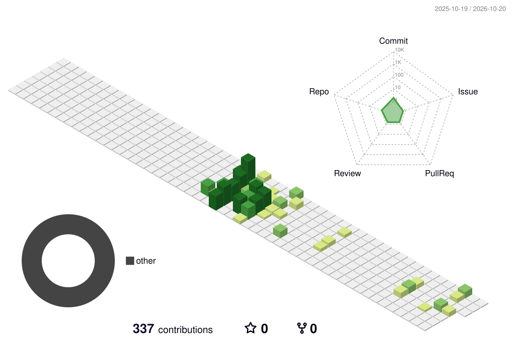

  

  <h1>UMUT BERK İNCE</h1>
  
<strong>Öğreniyor, üretiyor ve her projede yeni bir şey keşfediyorum.</strong>

  
<a href="https://github.com/umutberknc">@umutberknc</a>

---

## 👾 Hakkımda

Yazılım geliştirme yolculuğunun başındayım. Farklı fikirleri çalışan projelere dönüştürürken web teknolojileri, otomasyon ve yapay zekâ destekli ürünler üzerine öğrenmeye devam ediyorum. Benim için her proje yeni bir deneyim alanı.

## ⚡ Öne çıkan projeler

| Proje | Açıklama |
|---|---|
| [TURK Label](https://turklabel.com) | Kendi projem. Ürünleri Amazon pazar yerlerinde listeleme sürecini yapay zekâ ve otomasyonla kolaylaştırmaya odaklanıyor. |
| [Kişisel web projem](https://github.com/umutberknc/umutberk138.github.io) | GitHub Pages üzerinde yayımlanan kişisel web projem. |

> Bazı çalışmalarımı özel depolarda tutuyorum; bu nedenle özel depo adları ve içerikleri bu profilde yer almıyor.

## 🧰 Projelerimde kullandığım teknolojiler

Depolarımdaki kodlara göre kullandığım ve üzerinde çalıştığım diller/teknolojiler:

## 📈 Katkı grafiğim

  

## 🐍 Katkılarımın izi

  <picture>
    <source media="(prefers-color-scheme: dark)" srcset="./dist/github-snake-dark.svg" />
    <source media="(prefers-color-scheme: light)" srcset="./dist/github-snake.svg" />
    
  </picture>

---

  Şimdilik öğrenme modundayım. Yeni projeler ve deneyimler geldikçe bu profil de gelişecek.

